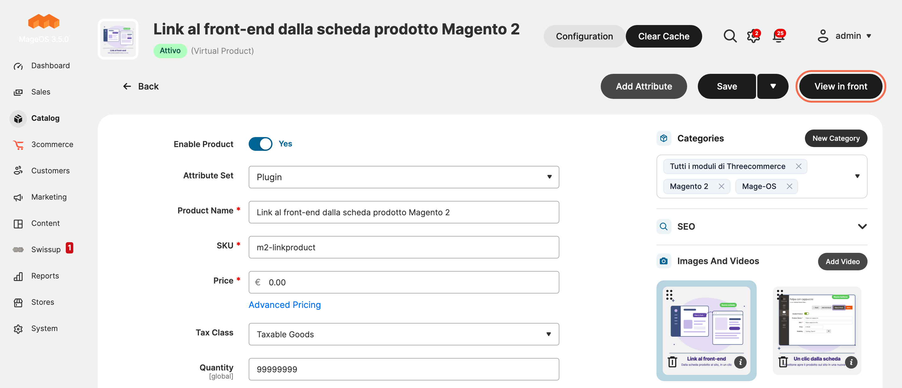

# Threecommerce_ViewProduct: "View in front" button on the Magento 2 product edit page

A small module that adds a **View in front** button to the product edit page in the admin. One click opens the product page on the storefront in a new tab, so you can check the result right after saving.



**Compatibility:** Magento Open Source / Adobe Commerce 2.4.4 – 2.4.9 · Mage-OS 1.x / 3.x · PHP 8.1 – 8.4 · Any frontend theme (admin-only)
**License:** free · **Current version:** see [Releases](../../releases)

## Features

- **View in front** button in the toolbar of Catalog → Products → Edit.
- Uses the product storefront URL, including **URL rewrites** and the configured product URL suffix.
- **Store view aware:** if you switch the store view in the product page, the button opens the product in that store view (otherwise the default one).
- The button is hidden when the product has no page on the storefront (disabled, *Not Visible Individually*, *Search* only, or without URL key).
- Works with any frontend theme (Luma, Hyvä, Breeze): it only touches the admin.
- Italian translation included.

## Requirements

- Magento Open Source / Adobe Commerce 2.4.4+ or Mage-OS
- PHP 8.1 – 8.4
- Native module: `Magento_Catalog`
- Package: `threecommerce/m2-base` (installed automatically by Composer)

## Installation

The package is distributed through our Composer repository at `repo.threecommerce.it`. Request the credentials from the [product page](https://www.threecommerce.it/link-front-end-scheda-prodotto-magento-2?utm_source=github&utm_medium=readme&utm_campaign=magento2-view-product-in-frontend), then:

```bash
composer config repositories.threecommerce composer https://repo.threecommerce.it
composer require threecommerce/m2-linkproduct
bin/magento module:enable Threecommerce_ViewProduct
bin/magento setup:upgrade
bin/magento cache:flush
```

## Configuration

No configuration needed: the button appears on the product edit page after installation.

## Documentation and support

- Product page: [threecommerce.it/link-front-end-scheda-prodotto-magento-2](https://www.threecommerce.it/link-front-end-scheda-prodotto-magento-2?utm_source=github&utm_medium=readme&utm_campaign=magento2-view-product-in-frontend)
- [Changelog](CHANGELOG.md) (in Italian)
- Support and custom development: [threecommerce.it/contatti](https://www.threecommerce.it/contatti?utm_source=github&utm_medium=readme&utm_campaign=magento2-view-product-in-frontend)

---

*This repository is the public showcase of the module. The source code is kept in a private repository.*
